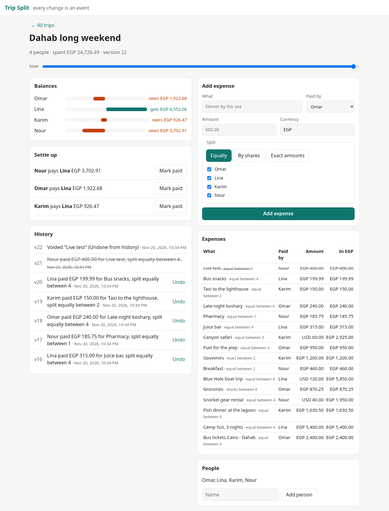
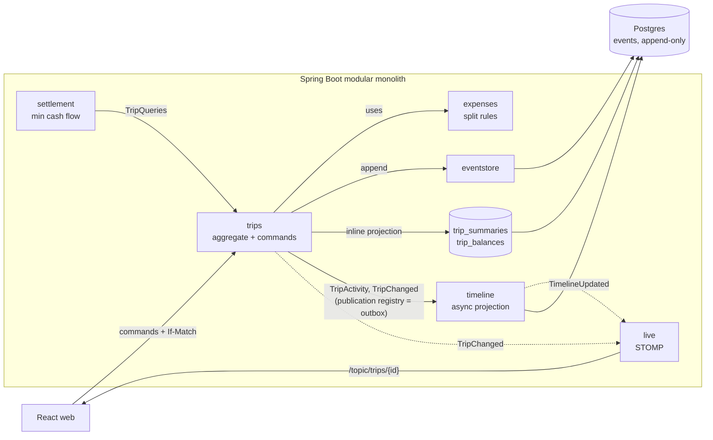

# Trip Split

**Split trip costs with friends: live balances, the fewest transfers to settle up, and the full history.**

Log who paid what, in any currency, and split it equally, by shares or by exact amounts. Trip Split keeps every
balance exact to the piaster, tells you the fewest transfers that settle the trip, and lets you scroll back to
"what did we owe each other on Saturday night?" Every change is an event, so nothing is ever lost and undo is just
another event.



Java 25 · Spring Boot 4.2 · Spring Modulith · event sourcing on plain Postgres · STOMP WebSockets · React + Vite.

## What it does

- **Trips and people** – start a trip in a base currency, add people at any time.
- **Three split rules** – equally, by shares (a couple counts 2) or exact amounts; foreign-currency expenses carry
  the rate used. Shares always add up to the total: the leftover piaster goes to whoever joined first.
- **Balances, live** – who is owed and who owes, pushed to every open browser over a WebSocket.
- **Settle up in at most n-1 transfers** – greedy min-cash-flow; "Mark paid" records the settlement.
- **History with undo** – a timeline of every event; undo is a compensating event, the original stays visible.
- **Time travel** – a slider (and `?asOf=` on the API) replays the trip up to any moment.
- **Safe concurrent edits** – every response carries the trip version as an `ETag`; a write with a stale
  `If-Match` gets `412` instead of silently overwriting a friend's change.

## Architecture

One deployable, cut into modules that Spring Modulith verifies. Commands append events to a Postgres event store
and update the inline projections in the same transaction; module events go through Spring Modulith's event
publication registry (a transactional outbox) to the asynchronous timeline and the live push.



```
src/main/java/dev/tripsplit/
  money/        shared kernel: Money (long minor units + currency), Allocation (largest remainder)
  eventstore/   EventStore API · internal/JdbcEventStore (UNIQUE(stream_id, version))
  expenses/     domain/ SplitRule (sealed: Equal | Exact | Shares), ExpenseSplitter
  trips/        domain/ Trip aggregate + TripEvent (sealed records) · application/ commands, queries, ports
                adapter/ persistence (event codec, read models) · web (REST, ETag) · demo seeder
  settlement/   domain/ SettleUp (greedy) · adapter/web
  timeline/     application/ TimelineProjector (@ApplicationModuleListener) · adapter/ jdbc, web
  live/         STOMP config, LiveTripUpdates
web/            React + Vite + TypeScript, @stomp/stompjs
```

## Quickstart

Requirements: Docker (or Podman with the Docker CLI).

```bash
cp .env.example .env                 # optional; set TRIPSPLIT_DEMO_DATA=true for an invented demo trip
docker compose up -d --build --wait
open http://localhost:8090
./scripts/smoke.sh                   # create trip, 3 expenses, balances sum to zero, 412 on stale If-Match, void
docker compose down -v
```

The demo trip, "Dahab long weekend", has four invented people and 15 expenses in EGP and USD.

### Local development

Requirements: JDK 25 and Node 22+. Maven comes from the wrapper.

```bash
./mvnw spring-boot:test-run          # API on :8080 with a throwaway Postgres from Testcontainers
cd web && npm install && npm run dev # UI on :5173, proxies /api and /ws to :8080
```

Or against your own Postgres: `DATABASE_URL=jdbc:postgresql://localhost:5432/tripsplit ./mvnw spring-boot:run`.

### Checks

```bash
./mvnw verify                        # -Xlint:all -Werror, Spotless, unit + jqwik properties, ArchUnit,
                                     # Spring Modulith verify, Testcontainers integration tests
./mvnw spotless:apply                # format (google-java-format)
cd web && npm run lint && npm run build && npm test
```

## API sketch

```http
POST /api/trips                                  {"name":"Dahab","baseCurrency":"EGP","members":["Omar","Lina"]}
GET  /api/trips                                  trip list (read model)
GET  /api/trips/{id}?asOf=2026-11-20T18:00:00Z   full trip by replay; ETag: "7"
POST /api/trips/{id}/members                     If-Match: "7"   {"name":"Karim"}
POST /api/trips/{id}/expenses                    If-Match: "8"
     {"description":"Boat","paidBy":"…","amount":"40.00","currency":"USD","rate":"48.75",
      "split":{"kind":"SHARES","shares":{"…":1,"…":2}}}
POST /api/trips/{id}/expenses/{eid}/void         compensating event {"reason":"paid twice"}
POST /api/trips/{id}/settlements                 {"from":"…","to":"…","amount":"250.00"}
POST /api/trips/{id}/settlements/{sid}/void
GET  /api/trips/{id}/balances?asOf=…             inline projection (now) or replay (asOf)
GET  /api/trips/{id}/settle-up?asOf=…            fewest transfers
GET  /api/trips/{id}/timeline                    async projection, newest first
GET  /api/trips/{id}/events                      the raw stream, for the curious
WS   /ws  (STOMP)  SUBSCRIBE /topic/trips/{id}   {"type":"balances"|"timeline","version":…}
```

Money is sent as decimal strings and returned as integer minor units plus a currency. Errors are RFC 9457
problem details: 404 unknown ids, 422 broken rules, 412 stale version. Health: `/actuator/health/readiness`;
module structure: `/actuator/modulith`.

## Design notes (talking points)

1. **When event sourcing pays.** Shared money needs an audit trail, undo and "as of" answers; storing events gives
   all three by construction. The costs are real: replays on read, projections to maintain, and event schemas that
   can only evolve additively or through upcasters (type names are versioned: `trip.expense-added.v1`).
   ([ADR 2](docs/adr/0002-event-sourcing-hand-rolled-on-postgres.md))
2. **An event store is a table and a unique index.** `UNIQUE (stream_id, version)` is the whole optimistic
   concurrency story; the same version is the HTTP `ETag`, so a stale `If-Match` becomes `412`. Postgres also gives
   one transaction for the append and the inline projection, which a separate event database cannot.
3. **Facts, not formulas.** `ExpenseAdded` stores the computed shares and the rate used. Fixing a rounding rule
   tomorrow cannot rewrite last week's balances on replay.
4. **Money correctness.** `long` minor units, exact parsing, one half-even conversion per expense, then the
   largest-remainder method with join-order tie-breaks, so shares always add up and balances always net to zero.
   jqwik checks it on thousands of random splits. ([ADR 3](docs/adr/0003-money-as-minor-units-and-remainder-rule.md))
5. **Debt simplification.** Greedy biggest-debtor-pays-biggest-creditor zeroes at least one person per transfer,
   so at most n-1 transfers. The true minimum is NP-hard (it hides subset-sum: subgroups that cancel among
   themselves); for a holiday group greedy is usually optimal or one transfer longer. Property tests check
   "transfers ≤ n-1 and everyone ends at zero" on random groups.
6. **Modular monolith, verified.** Spring Modulith fails the build on cycles or reaching into another module's
   internals; ArchUnit keeps each module's `domain` free of Spring, Jackson and JDBC. Module events go through the
   event publication registry: stored in the command's transaction, delivered after commit, retried after a
   crash; listeners are idempotent on `(trip_id, version)`. ([ADR 4](docs/adr/0004-spring-modulith-modular-monolith.md))
7. **CQRS falls out naturally.** Commands append; "now" reads hit projections; "then" reads replay. The timeline is
   eventually consistent on purpose and the UI refreshes it when the `timeline` WebSocket message arrives.

## Status

MVP, single-tenant, no authentication: run it for your group on your own machine or network. Rates are entered by
hand. Stretch ideas: quick-entry parser ("dinner 600 split with Omar and Lina", rules first, optional free LLM off
by default), exchange rates from a free keyless API (cached, rate still stored per expense), CSV export,
itinerary items.

Known limits: `asOf` trusts the API server's clock; the in-memory STOMP broker means one API instance (a relay to
RabbitMQ's STOMP plugin would lift that); member names cannot be changed yet.

## Extracted from Lingo

Trip Split is extracted from **Lingo**, a private personal-assistant app, where trip expenses and bill splitting
first lived as plain tables in TypeScript. This repository is a clean re-implementation in Java with event
sourcing, a fresh history and invented sample data only.

## License

[MIT](LICENSE)
